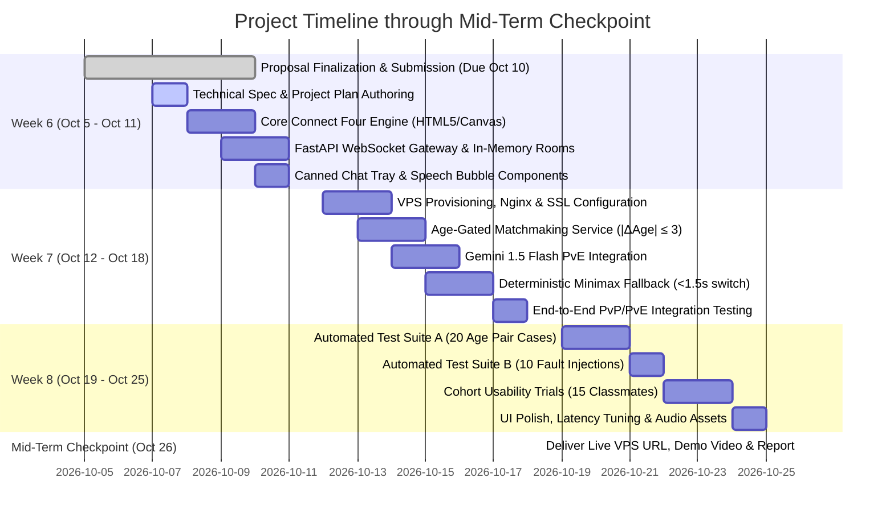

# ConnectFour Connect (AILT9019 G31) — Project Plan

**Course**: AILT9019 · AI Literacy II  
**Project**: Activity-Mediated Social Mini-Game with AI Fallback Agent  
**Target Milestone**: Mid-Term Checkpoint (Monday, October 26)  
**Document Version**: 1.0.0 (Post-Proposal Revision)  
**Last Updated**: October 7, 2026  

---

## 1. Executive Summary & Project Vision

### 1.1 Problem Statement & Solution
Traditional digital social platforms place heavy burdens on appearance swiping, detailed biographical profiles, and awkward text-based icebreakers. This causes high social anxiety and conversational fatigue among university students. 

**ConnectFour Connect** introduces an **activity-mediated social interaction prototype**:
- Students meet peers over a low-stakes, turn-based browser game (Connect Four, 7 columns × 6 rows).
- Interpersonal interaction is mediated through safe canned phrases (6 preset phrases) and reactions (4 stickers)—zero free-form text chat.
- An in-memory matchmaking queue pairs users with peers of similar age ($|\Delta\text{Age}| \le 3$, Age $\ge 18$) within 15 seconds.
- If no peer is available within 15 seconds, a seamless backend **AI Fallback Agent (Google Gemini 1.5 Flash)** steps in, ensuring zero wait-time and 100% service availability.
- A local deterministic minimax heuristic guarantees fail-safe continuity if upstream LLM APIs experience rate limits, latency, or outages.

---

## 2. Project Scope & Boundary Management

```
┌────────────────────────────────────────────────────────────────────────┐
│                        PROJECT SCOPE MATRIX                            │
├───────────────────────────────────┬────────────────────────────────────┤
│           IN SCOPE (Must/Should)  │         OUT OF SCOPE (Won't)       │
├───────────────────────────────────┼────────────────────────────────────┤
│ • Responsive HTML5/Canvas Web App │ • Native iOS/Android Mobile Apps   │
│ • FastAPI + WebSocket Game Server │ • Persistent Databases / User PII  │
│ • Age-gated Matchmaking (15s cap) │ • Free-form Unmoderated Text Chat  │
│ • Gemini 1.5 Flash PvE Bot        │ • Audio / Video Calling            │
│ • Local Deterministic Minimax Bot │ • Dating / Matchmaking Profiles    │
│ • Canned Social Reaction Tray     │ • Offline Meetup Coordination      │
│ • Remote Ubuntu VPS + SSL Deploy  │ • Desktop Agent / Pi Agent Harness │
└───────────────────────────────────┴────────────────────────────────────┘
```

### 2.1 Acceptance Criteria
| Tier | Deliverable | Target Validation |
| :--- | :--- | :--- |
| **Must-Have** | Turn-based 7×6 Connect Four Engine | Win (4 in row), draw (42 full), 30s turn countdown |
| **Must-Have** | Age-Gated Matchmaking Service | Age $\ge 18$, $\|\Delta\text{Age}\| \le 3$, 15s queue timeout |
| **Must-Have** | Real-Time WebSocket Synchronization | Room partitioning, turn transitions, disconnect recovery |
| **Must-Have** | Server-Side LLM PvE Agent | Gemini 1.5 Flash with strict JSON schema outputs |
| **Must-Have** | Deterministic Minimax Fallback | Activates in $<1.5\text{s}$ upon LLM timeout/error |
| **Must-Have** | Canned Communication Tray | 6 phrases, 4 stickers; zero free-text vulnerability |
| **Should-Have** | Dual AI Personalities | "Casual Explorer" vs. "Tactical Challenger" |
| **Should-Have** | Post-Match Mutual Rematch | Rematch handshake without re-entering queue |
| **Should-Have** | Token-drop Physics & Audio FX | Micro-animations and crisp acoustic token drop sounds |

---

## 3. Work Breakdown Structure (WBS) & Task Ownership

```mermaid
graph TD
    Project["ConnectFour Connect (AILT9019 G31)"]
    
    Project --> WP1["WP1: Game Engine & Frontend Client"]
    Project --> WP2["WP2: Backend Networking & Matchmaking"]
    Project --> WP3["WP3: AI Agent & Heuristic Fallback"]
    Project --> WP4["WP4: DevOps, Infrastructure & Security"]
    Project --> WP5["WP5: Testing, Evaluation & Documentation"]

    WP1 --> T11["T1.1 Canvas 7x6 Grid & Gravity Drop"]
    WP1 --> T12["T1.2 Turn Indicators & 30s Timer"]
    WP1 --> T13["T1.3 Canned Chat Tray & Speech Bubbles"]
    WP1 --> T14["T1.4 Onboarding Modal & Game Summary"]

    WP2 --> T21["T2.1 FastAPI App & WebSocket Gateway"]
    WP2 --> T22["T2.2 In-Memory Room Manager"]
    WP2 --> T23["T2.3 Age-Gated FIFO Queue (|ΔAge|≤3)"]
    WP2 --> T24["T2.4 Disconnect & State Recovery"]

    WP3 --> T31["T3.1 Gemini 1.5 Flash JSON Integration"]
    WP3 --> T32["T3.2 Prompt Design & Board Serializer"]
    WP3 --> T33["T3.3 Deterministic Minimax Engine"]
    WP3 --> T34["T3.4 Dual Bot Persona Tuning"]

    WP4 --> T41["T4.1 Ubuntu VPS Setup & Hardening"]
    WP4 --> T42["T4.2 Nginx Reverse Proxy & WSS/SSL"]
    WP4 --> T43["T4.3 Systemd Service Daemonization"]

    WP5 --> T51["T5.1 Test Suite A (20 Age Pairs)"]
    WP5 --> T52["T5.2 Test Suite B (10 Fault Injections)"]
    WP5 --> T53["T5.3 15-Classmate Usability Trials"]
    WP5 --> T54["T5.4 Mid-Term Demo Video & Report"]
```



---

## 4. Sprint Schedule & Timeline (Weeks 6 – 8)



### Detailed Week-by-Week Milestones

#### Week 6: Core Foundations (Oct 5 – Oct 11)
- **Goal**: Working local PvP prototype on localhost.
- **Tasks**:
  1. Finalize proposal revision submission by Saturday Oct 10.
  2. Implement HTML5 Canvas Connect Four game board with column click detection and gravity animation.
  3. Build FastAPI WebSocket server managing client connections, room creation, and move broadcasts.
  4. Develop canned communication tray (6 phrases, 4 stickers) with visual speech bubble badges.
- **Exit Gate**: Two browser tabs on `localhost:8000` can play a full 7×6 match to completion with canned reactions.

#### Week 7: AI Core & VPS Deployment (Oct 12 – Oct 18)
- **Goal**: Cloud deployment with live AI fallback.
- **Tasks**:
  1. Deploy FastAPI backend onto Ubuntu Linux VPS, configure Nginx reverse proxy with HTTPS and WSS (Let's Encrypt SSL).
  2. Implement in-memory matchmaking queue with 15-second countdown timer and $|\Delta\text{Age}| \le 3$ age filtering.
  3. Integrate Google Gemini 1.5 Flash API via structured JSON response (`{"column": int, "canned_reaction_id": int}`).
  4. Build server-side deterministic Minimax heuristic bot with 1.5s timeout trigger to handle API disruptions.
- **Exit Gate**: Solo player queues for 15s $\rightarrow$ automatically transitions into PvE match against Gemini/heuristic bot on public HTTPS URL.

#### Week 8: Verification, Polish & Cohort Testing (Oct 19 – Oct 25)
- **Goal**: Empirical validation, quantitative test passing, and user trials.
- **Tasks**:
  1. Run **Test Suite A** (20 automated age pairs: 10 valid, 5 age-gap refused, 5 underage/malformed).
  2. Run **Test Suite B** (10 simulated fault injections: HTTP 500, 429, timeout forced).
  3. Conduct 15-student user evaluation cohort (PvP + PvE, Likert survey).
  4. Implement stretch features: dual AI personalities, mutual rematch button, audio effects.
- **Exit Gate**: 100% pass rate on Suites A & B; $\ge 85\%$ task completion rate and $\ge 4.0/5.0$ Likert score from cohort.

#### Mid-Term Checkpoint (Mon Oct 26)
- **Goal**: Full submission package delivered.
- **Deliverables**:
  1. Live public HTTPS URL with 24/7 uptime.
  2. Walkthrough demonstration video (3–5 minutes).
  3. Comprehensive test suite execution logs and cohort Likert results.
  4. Prototype progress report.

---

## 5. Risk Assessment & Mitigation Matrix

| Risk ID | Description | Likelihood | Impact | Concrete Mitigation |
| :---: | :--- | :---: | :---: | :--- |
| **R-01** | **LLM API Latency / Quota Exhaustion**<br>Gemini API rate limits or takes $>2.5\text{s}$ to respond. | High | High | Server maintains a strict 1.5s response deadline; instantly falls back to local deterministic minimax solver without interrupting the WebSocket session. |
| **R-02** | **Player Age Spoofing & Underage Access**<br>Minors entering or adults pairing with large age gaps. | Med | Critical | Strict registration barrier rejects Age $<18$. Strict $|\Delta\text{Age}| \le 3$ rule enforced server-side. Zero persistent PII stored. |
| **R-03** | **WebSocket Connection Drops / Mobile Sleep**<br>Mobile browser switches apps or drops Wi-Fi. | High | Med | Ping/pong heartbeat every 5s; 10s reconnection grace period before declaring forfeit or switching opponent to AI. |
| **R-04** | **VPS Memory Bloat under Load**<br>Abandoned WebSocket rooms leaking memory. | Med | Med | Rooms are strictly ephemeral. `disconnect` triggers explicit cleanup of room state. Target memory consumption $<50\text{MB}$ RAM. |
| **R-05** | **LLM Hallucinating Illegal Columns**<br>Model returns full column or out-of-bound integer. | Med | Low | Server-side validation parses output; if column is invalid, falls back to deterministic heuristic within 100ms. |

---

## 6. Success Metrics & Verification Targets

1. **System Availability**: $99.9\%$ during testing period (guaranteed by PvE fallback).
2. **Matchmaking Latency**: Match formed in $\le 15\text{s}$ (PvP if peer present, PvE otherwise).
3. **Turn Processing Latency**: Human move broadcast $<100\text{ms}$; AI move generated $<2.5\text{s}$.
4. **Automated Test Coverage**:
   - Test Suite A (Age filtering): 20/20 (100%) passing.
   - Test Suite B (Fault injection): 10/10 (100%) passing.
5. **Human Cohort Usability**:
   - Completion Rate: $\ge 85\%$ (at least 13 of 15 testers finish end-to-end game).
   - Usability & Comfort Score: $\ge 4.0 / 5.0$ average on post-match 5-point Likert scale.
