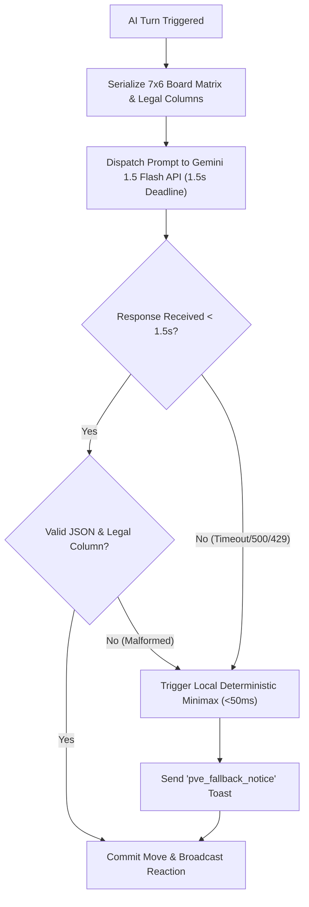

# ConnectFour Connect (AILT9019 G31) — Technical Specification

**Project**: Activity-Mediated Social Mini-Game with AI Fallback Agent  
**Module**: Technical Architecture, Protocol, & Engine Specification  
**Version**: 1.0.0  
**Target Milestone**: Mid-Term Checkpoint (Monday, October 26)  
**Status**: Approved for Implementation  

---

## 1. System Architecture & Topology

### 1.1 High-Level Architecture Diagram
The system follows a lightweight, real-time client-server architecture designed for sub-100ms latency, zero persistent storage of personal data, and instant automated fallback to local heuristics.

```
┌────────────────────────────────────────────────────────────────────────┐
│                        CLIENT TIER (Browser)                           │
│  • HTML5 / Canvas 2D Board Renderer (7x6 Grid)                         │
│  • Canned Interaction Tray (6 Preset Phrases, 4 Stickers)              │
│  • WebSocket Client & Turn Countdown Timer (30s)                       │
└─────────────────────────────────┬──────────────────────────────────────┘
                                  │ HTTPS / WSS (TLS 1.3)
                                  ▼
┌────────────────────────────────────────────────────────────────────────┐
│                     INFRASTRUCTURE TIER (Ubuntu VPS)                   │
│  • Nginx Reverse Proxy (SSL Termination, WSS Upgrades)                 │
│  • Uvicorn ASGI Server (FastAPI Daemon, Systemd Managed)               │
└─────────────────────────────────┬──────────────────────────────────────┘
                                  │
                                  ▼
┌────────────────────────────────────────────────────────────────────────┐
│                    APPLICATION TIER (FastAPI Backend)                  │
│                                                                        │
│  ┌───────────────────────┐          ┌───────────────────────────────┐  │
│  │  Matchmaking Engine   │          │     In-Memory Room Manager    │  │
│  │  • Age Filter (|Δ|≤3) │          │  • Thread-safe match rooms    │  │
│  │  • 15s Queue Timeout  │          │  • Ephemeral state in RAM     │  │
│  └───────────┬───────────┘          └───────────────┬───────────────┘  │
│              │                                      │                  │
│              ▼                                      ▼                  │
│  ┌──────────────────────────────────────────────────────────────────┐  │
│  │                      Connect Four Engine                         │  │
│  │  • 7x6 Grid Matrix & Gravity Physics                             │  │
│  │  • 4-in-a-Row Detection (Horizontal, Vertical, Diagonals)        │  │
│  │  • Turn Validation & 30s Timeout Enforcer                        │  │
│  └──────────────────────────────────┬───────────────────────────────┘  │
│                                     │                                  │
│              ┌──────────────────────┴──────────────────────┐           │
│              ▼                                             ▼           │
│  ┌───────────────────────────────┐           ┌──────────────────────┐  │
│  │ Primary AI: Gemini 1.5 Flash  │           │ Fallback AI: Minimax │  │
│  │ • Structured JSON Schema      │           │ • Alpha-Beta Pruning │  │
│  │ • Latency Budget: < 1.5s      │ ──[Fail]─►│ • Deterministic      │  │
│  │ • Canned Social Reaction Pick │           │ • Latency: < 50ms    │  │
│  └───────────────────────────────┘           └──────────────────────┘  │
└────────────────────────────────────────────────────────────────────────┘
```

---

## 2. Data Models & Schemas

### 2.1 Core Entities

#### Player Session Model
```python
from pydantic import BaseModel, Field
from typing import Optional

class PlayerSession(BaseModel):
    session_id: str
    nickname: str = Field(..., min_length=2, max_length=16)
    birth_year: int = Field(..., ge=1920, le=2008)  # Age >= 18 check
    calculated_age: int
    is_bot: bool = False
    connected: bool = True
```

#### Room State Model
```python
from enum import IntEnum
from typing import List, Optional

class CellState(IntEnum):
    EMPTY = 0
    PLAYER_1 = 1  # Red
    PLAYER_2 = 2  # Yellow / Bot

class GameStatus(str, Enum):
    WAITING = "waiting"
    IN_PROGRESS = "in_progress"
    FINISHED = "finished"

class ConnectFourRoom(BaseModel):
    room_id: str
    is_pve: bool = False
    player_1: PlayerSession
    player_2: PlayerSession
    current_turn: int = 1  # 1 or 2
    board: List[List[int]]  # 6 rows x 7 cols (0 = empty, 1 = P1, 2 = P2)
    status: GameStatus = GameStatus.IN_PROGRESS
    winner: Optional[int] = None  # 1, 2, 0 (draw), or None
    winning_coordinates: Optional[List[List[int]]] = None
    move_count: int = 0
    turn_deadline_ts: float
```

---

## 3. WebSocket Real-Time Protocol Specification

All frames exchanged over `/ws/game` are UTF-8 encoded JSON objects containing `type` and `payload`.

### 3.1 Client-to-Server (C2S) Events

#### 1. `queue_join`
Sent immediately after user submits guest registration modal.
```json
{
  "type": "queue_join",
  "payload": {
    "nickname": "Alex",
    "birth_year": 2003
  }
}
```

#### 2. `player_move`
Sent when the active player clicks a column.
```json
{
  "type": "player_move",
  "payload": {
    "column": 3
  }
}
```

#### 3. `send_reaction`
Sent when a player clicks a canned phrase or reaction sticker.
```json
{
  "type": "send_reaction",
  "payload": {
    "category": "phrase",
    "id": 2
  }
}
```
*Category values: `"phrase"` (IDs 1–6) or `"sticker"` (IDs 1–4).*

#### 4. `rematch_request`
Sent on the game summary screen to challenge the same opponent.
```json
{
  "type": "rematch_request",
  "payload": {}
}
```

---

### 3.2 Server-to-Client (S2C) Events

#### 1. `queue_status`
Broadcasts queue progression during the 15-second matchmaking countdown.
```json
{
  "type": "queue_status",
  "payload": {
    "status": "searching",
    "elapsed_seconds": 6,
    "timeout_seconds": 15
  }
}
```

#### 2. `match_found`
Sent when a PvP match is paired or PvE fallback triggers.
```json
{
  "type": "match_found",
  "payload": {
    "room_id": "rm_7f8a12",
    "is_pve": false,
    "assigned_player": 1,
    "assigned_color": "red",
    "opponent_nickname": "Jordan",
    "opponent_age": 22,
    "turn_duration_seconds": 30
  }
}
```

#### 3. `board_update`
Dispatched whenever a valid token drops into the grid.
```json
{
  "type": "board_update",
  "payload": {
    "board": [
      [0, 0, 0, 0, 0, 0, 0],
      [0, 0, 0, 0, 0, 0, 0],
      [0, 0, 0, 0, 0, 0, 0],
      [0, 0, 0, 0, 0, 0, 0],
      [0, 0, 0, 1, 0, 0, 0],
      [0, 0, 2, 1, 2, 0, 0]
    ],
    "last_move": {
      "player": 1,
      "column": 3,
      "row": 4
    },
    "current_turn": 2,
    "turn_deadline_ts": 1775554320.5
  }
}
```

#### 4. `broadcast_reaction`
Relays an opponent's canned communication to the client.
```json
{
  "type": "broadcast_reaction",
  "payload": {
    "from_player": 2,
    "category": "sticker",
    "id": 1,
    "text": "👍"
  }
}
```

#### 5. `game_over`
Announces match conclusion with outcome and winning coordinates.
```json
{
  "type": "game_over",
  "payload": {
    "winner": 1,
    "reason": "connect4",
    "winning_coordinates": [
      [2, 3],
      [3, 3],
      [4, 3],
      [5, 3]
    ],
    "stats": {
      "turns": 18,
      "duration_seconds": 142
    }
  }
}
```

#### 6. `pve_fallback_notice`
Sent when upstream LLM fails, indicating seamless switch to local bot.
```json
{
  "type": "pve_fallback_notice",
  "payload": {
    "message": "AI opponent operating in local fallback mode."
  }
}
```

---

## 4. Connect Four Game Engine & Physics

### 4.1 Board Coordinates & Matrix Convention
- **Grid Size**: 7 columns (index $0 \le c \le 6$) by 6 rows (index $0 \le r \le 5$).
- **Origin**: Row 0 is the top row; Row 5 is the bottom (gravity floor).
- **Gravity Drop Logic**:
  Given a selected column $c$:
  $$\text{Target Row } r = \max \{i \in [0, 5] \mid \text{board}[i][c] == 0\}$$
  If no such row exists, the column is full and the move is rejected as illegal.

### 4.2 Win Detection Algorithm
After token $(r, c)$ drops for player $P$, check for 4 consecutive tokens along 4 axes:
1. **Horizontal**: $(r, c + k)$ for $k \in [-3, 3]$
2. **Vertical**: $(r + k, c)$ for $k \in [-3, 3]$
3. **Positive Diagonal** ($\nearrow$): $(r - k, c + k)$ for $k \in [-3, 3]$
4. **Negative Diagonal** ($\searrow$): $(r + k, c + k)$ for $k \in [-3, 3]$

If any contiguous streak reaches length 4, flag immediate win and record the 4 coordinate pairs for client highlighting.

### 4.3 Draw Condition
If `move_count == 42` and no 4-in-a-row exists, set `winner = 0` (Draw).

### 4.4 Turn Timers
- Turn deadline: 30 seconds per turn.
- If deadline expires: The server auto-plays the lowest unoccupied central column or declares forfeit.

---

## 5. AI Orchestration & Minimax Fallback Engine



### 5.1 Primary AI: Google Gemini 1.5 Flash
- **API Target**: Google Gemini 1.5 Flash via official SDK / REST API.
- **Output Format Constraint**: Strict JSON Schema:
```json
{
  "type": "object",
  "properties": {
    "column": {
      "type": "integer",
      "description": "Selected column index from 0 to 6"
    },
    "canned_reaction_id": {
      "type": "integer",
      "description": "Optional reaction ID (1-6 for phrase, or 0 for none)"
    }
  },
  "required": ["column", "canned_reaction_id"]
}
```

- **System Prompt Design**:
```text
You are playing Connect Four on a 7x6 grid. Your token is 2 (Yellow), opponent is 1 (Red).
Current board matrix:
{board_matrix}
Legal columns available: {legal_columns}
You must pick the strategically best legal column to connect 4 or block your opponent.
Respond STRICTLY with the requested JSON schema.
```

### 5.2 Deterministic Minimax Fallback Bot
- **Activation Criteria**: Triggered immediately if:
  1. Gemini API fails to return within 1.5 seconds.
  2. Gemini API returns HTTP 429 (rate limit) or HTTP 500 (internal error).
  3. Gemini returns an invalid or full column index.
- **Algorithm**:
  - Minimax with Alpha-Beta Pruning (Search Depth: 4).
  - **Evaluation Heuristic**:
    - Win line (+100,000)
    - 3-in-a-row with open end (+500)
    - 2-in-a-row with open end (+50)
    - Center column bonus (+30)
    - Opponent threats evaluated symmetrically as negative penalties.
  - Execution runtime: $<30\text{ms}$ on VPS CPU, guaranteeing zero lag.

---

## 6. Matchmaking & Queue Engine

### 6.1 Age Constraint Formula
For registration with current year $Y$:
$$\text{Age} = Y - \text{birth\_year}$$
- Hard filter: $\text{Age} \ge 18$. (Birth year $\le 2008$).
- Pair compatibility: For user $A$ and user $B$:
$$|\text{Age}_A - \text{Age}_B| \le 3$$

### 6.2 Queue Lifecycle
1. User enters queue $\rightarrow$ added to `MatchingPool` with timestamp $T_0$.
2. Every 1.0 second:
   - Scan matching pool FIFO.
   - For candidate $A$, search pool for candidate $B$ satisfying $|\text{Age}_A - \text{Age}_B| \le 3$.
   - If found: remove $A$ and $B$, construct `ConnectFourRoom(is_pve=False)`, notify both clients.
3. If $T_{current} - T_0 \ge 15.0\text{s}$:
   - Pop candidate $A$ from matching pool.
   - Construct `ConnectFourRoom(is_pve=True, player_2=BotSession)`.
   - Dispatch `match_found` event to client $A$.

---

## 7. Canned Social Interaction Palette

To eliminate harassment, toxicity, and personal data leakage, users and AI agents communicate exclusively through a fixed palette:

### 7.1 Preset Phrases (IDs 1–6)
| ID | Preset Phrase | Semantic Context |
| :-: | :--- | :--- |
| **1** | `"Good luck!"` | Match opening greeting |
| **2** | `"Nice move!"` | Sportsmanlike acknowledgment of good play |
| **3** | `"Thinking..."` | Signalling deliberate tactical contemplation |
| **4** | `"Close one!"` | Reacting to near-win or dramatic block |
| **5** | `"Well played!"` | End-game appreciation |
| **6** | `"Good game!"` | Match closing courtesy |

### 7.2 Reaction Stickers (IDs 1–4)
| ID | Sticker Symbol | Visual Effect |
| :-: | :---: | :--- |
| **1** | 👍 | Thumbs Up badge floating animation |
| **2** | 👏 | Applause badge with pulse effect |
| **3** | 🤔 | Thinking face with floating wobble |
| **4** | 🎉 | Celebration confetti burst |

---

## 8. Automated Test Suite Specifications

### 8.1 Test Suite A: Age Boundary & Demographic Filtering (20 Cases)

| Test ID | Account A Age | Account B Age | $|\Delta\text{Age}|$ | Expected Action | Acceptance Criteria |
| :---: | :---: | :---: | :---: | :--- | :--- |
| **A-01** | 18 | 18 | 0 | Pair PvP within 15s | 100% paired |
| **A-02** | 19 | 20 | 1 | Pair PvP within 15s | 100% paired |
| **A-03** | 20 | 22 | 2 | Pair PvP within 15s | 100% paired |
| **A-04** | 21 | 24 | 3 | Pair PvP within 15s | 100% paired (boundary) |
| **A-05** | 23 | 21 | 2 | Pair PvP within 15s | 100% paired |
| **A-06** | 25 | 22 | 3 | Pair PvP within 15s | 100% paired (boundary) |
| **A-07** | 24 | 24 | 0 | Pair PvP within 15s | 100% paired |
| **A-08** | 26 | 28 | 2 | Pair PvP within 15s | 100% paired |
| **A-09** | 22 | 25 | 3 | Pair PvP within 15s | 100% paired (boundary) |
| **A-10** | 30 | 30 | 0 | Pair PvP within 15s | 100% paired |
| **A-11** | 18 | 22 | 4 | Refuse PvP; Route to PvE | 100% refused pair |
| **A-12** | 19 | 25 | 6 | Refuse PvP; Route to PvE | 100% refused pair |
| **A-13** | 20 | 27 | 7 | Refuse PvP; Route to PvE | 100% refused pair |
| **A-14** | 22 | 28 | 6 | Refuse PvP; Route to PvE | 100% refused pair |
| **A-15** | 25 | 31 | 6 | Refuse PvP; Route to PvE | 100% refused pair |
| **A-16** | 17 | N/A | - | Immediate Refusal at Form | HTTP 400 / Inline Error |
| **A-17** | 15 | N/A | - | Immediate Refusal at Form | HTTP 400 / Inline Error |
| **A-18** | -5 | N/A | - | Immediate Refusal at Form | HTTP 400 / Inline Error |
| **A-19** | "abc" | N/A | - | Immediate Refusal at Form | HTTP 422 Unprocessable |
| **A-20** | null | N/A | - | Immediate Refusal at Form | HTTP 422 Unprocessable |

---

### 8.2 Test Suite B: LLM Fault Injection & Heuristic Fallback (10 Cases)

| Test ID | Injected Fault Type | Simulation Mechanism | Expected System Response | Latency Bound |
| :---: | :--- | :--- | :--- | :---: |
| **B-01** | HTTP 500 Internal Error | Mock Gemini client throws `500 Server Error` | Fallback to Minimax; notify client | $<1.5\text{s}$ |
| **B-02** | HTTP 500 Internal Error | Mock Gemini client throws `500 Server Error` | Fallback to Minimax; notify client | $<1.5\text{s}$ |
| **B-03** | HTTP 429 Quota Exhaustion | Mock Gemini client throws `RateLimitError` | Fallback to Minimax; notify client | $<1.5\text{s}$ |
| **B-04** | HTTP 429 Quota Exhaustion | Mock Gemini client throws `RateLimitError` | Fallback to Minimax; notify client | $<1.5\text{s}$ |
| **B-05** | Extreme Network Latency | Injected sleep `3.5s` on response | Timeout at 1.5s; Fallback to Minimax | $=1.5\text{s}$ |
| **B-06** | Extreme Network Latency | Injected sleep `5.0s` on response | Timeout at 1.5s; Fallback to Minimax | $=1.5\text{s}$ |
| **B-07** | Malformed JSON String | Returns `"I choose column three"` | Fallback to Minimax; notify client | $<1.5\text{s}$ |
| **B-08** | Illegal Column Value | Returns `{"column": 9}` | Fallback to Minimax; notify client | $<1.5\text{s}$ |
| **B-09** | Full Column Move | Returns column that is already full | Fallback to Minimax; notify client | $<1.5\text{s}$ |
| **B-10** | Upstream Socket Reset | Injected `ConnectionResetError` | Fallback to Minimax; notify client | $<1.5\text{s}$ |

---

## 9. Directory Structure & Implementation Roadmap

```
AILT9019_G31/
├── AILT9019_Revised_Proposal_G31.md    # Formal Proposal Submission
├── PROJECT_PLAN.md                     # Milestones, Sprints, WBS & Risks
├── TECHNICAL_SPEC.md                   # System Architecture, Protocols & Schemas
├── server/                             # FastAPI Backend Service
│   ├── app/
│   │   ├── __init__.py
│   │   ├── main.py                     # ASGI Entrypoint & WebSocket Router
│   │   ├── config.py                   # Environment & Gemini API Settings
│   │   ├── game_engine.py              # 7x6 Connect Four Physics & Rules
│   │   ├── matchmaking.py              # In-memory FIFO Queue & Age Filter
│   │   ├── room_manager.py             # Active Room Lifecycle & Session State
│   │   ├── ai/
│   │   │   ├── __init__.py
│   │   │   ├── gemini_client.py        # Gemini 1.5 Flash JSON Integration
│   │   │   └── minimax_fallback.py     # Deterministic Heuristic Bot
│   │   └── schemas.py                  # Pydantic Protocol Envelopes
│   └── requirements.txt                # FastAPI, Uvicorn, google-genai, websockets
├── client/                             # Frontend Web Application
│   ├── index.html                      # Single-page HTML5 Layout
│   ├── css/
│   │   └── style.css                   # Responsive Styling & Dark/Vibrant Theme
│   └── js/
│       ├── app.js                      # UI Controller & Onboarding Modal
│       ├── game_board.js               # Canvas 2D Board Rendering & Animation
│       ├── socket_client.js            # WebSocket Protocol Handler
│       └── canned_chat.js              # Reaction Tray & Speech Bubbles
├── tests/                              # Verification & Automated Test Suites
│   ├── test_connect4_engine.py         # Win/Draw/Gravity Engine Unit Tests
│   ├── test_suite_a_matchmaking.py     # 20 Age Boundary & Filter Cases
│   └── test_suite_b_fault_injection.py # 10 LLM Outage & Fallback Injections
└── deploy/                             # DevOps Deployment Files
    ├── nginx.conf                      # Nginx Reverse Proxy & WSS Config
    └── connectfour.service             # Systemd Daemon Configuration
```
